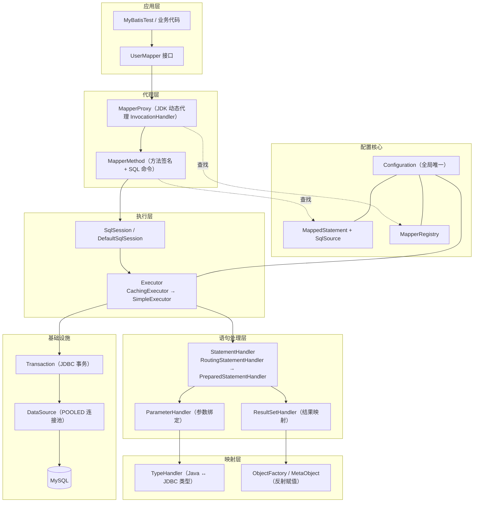
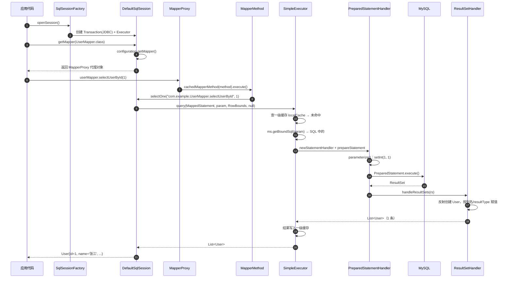

# MyBatis 原理与架构流程

> 本文基于本项目 `D:\Projects_for_study\MyBatis\mybatis` 的实际代码整理，涵盖核心原理、关键源码、架构分层与一次查询的完整调用链。

## 目录

- [0. 项目结构与职责](#0-项目结构与职责)
- [1. 一句话概括原理](#1-一句话概括原理)
- [2. 整体架构分层](#2-整体架构分层)
- [3. 架构流程：启动阶段与运行阶段](#3-架构流程启动阶段与运行阶段)
- [4. 核心原理逐个拆解](#4-核心原理逐个拆解)
- [5. 关键类清单](#5-关键类清单)
- [6. 总调用链](#6-总调用链)
- [7. 本项目注意事项](#7-本项目注意事项)

---

## 0. 项目结构与职责

```text
mybatis/
├── pom.xml                                  # Maven 依赖：MyBatis 3.5.14、MySQL 8.3.0、JUnit 4
├── sql/
│   └── schema.sql                           # 建库、建表、初始化数据
├── src/
│   ├── main/
│   │   ├── java/com/example/
│   │   │   ├── User.java                    # 实体类（POJO）
│   │   │   ├── UserMapper.java              # Mapper 接口（无实现类）
│   │   │   └── Main.java                    # 占位入口
│   │   └── resources/
│   │       ├── mybatis-config.xml           # 全局配置：环境、事务、数据源、Mapper 注册
│   │       └── mapper/
│   │           └── UserMapper.xml           # SQL 映射文件
│   └── test/java/com/example/
│       └── MyBatisTest.java                 # 真正跑通流程的测试入口
└── target/                                  # 构建产物（可删除）
```

| 文件 | 作用 |
|---|---|
| `pom.xml` | 引入 `mybatis 3.5.14`、`mysql-connector-j 8.3.0`、JUnit |
| `src/main/resources/mybatis-config.xml` | 全局配置：环境、事务、数据源、Mapper 注册 |
| `src/main/resources/mapper/UserMapper.xml` | SQL 映射文件，`namespace` 指向接口 |
| `src/main/java/com/example/UserMapper.java` | Mapper 接口（只有方法声明，没有实现类） |
| `src/main/java/com/example/User.java` | POJO，对应 `user` 表 |
| `sql/schema.sql` | 建库、建表、初始化 3 条数据 |
| `src/test/java/com/example/MyBatisTest.java` | 真正跑通流程的入口 |

---

## 1. 一句话概括原理

> MyBatis 是"半自动 ORM"：启动时把 **XML 配置 + Mapper XML** 解析成内存中的 `Configuration` 对象；运行时用 **JDK 动态代理** 拦截 Mapper 接口的方法调用，把"方法调用"翻译成 **SQL + 参数**，交给 JDBC 执行，最后用 **TypeHandler** 把 `ResultSet` 映射成 Java 对象。

因此可以做到：**只写接口不写实现类**，MyBatis 在运行时生成代理实现。

---

## 2. 整体架构分层



这张图从上到下就是一次调用的穿透路径，也是 MyBatis 官方源码的包结构顺序（`session → binding → executor → mapping → type → datasource`）。

---

## 3. 架构流程：启动阶段与运行阶段

### 3.1 启动阶段：解析配置，构建工厂

```mermaid
sequenceDiagram
    autonumber
    participant App as 应用代码
    participant Builder as SqlSessionFactoryBuilder
    participant XCB as XMLConfigBuilder
    participant CFG as Configuration
    participant XMB as XMLMapperBuilder
    participant REG as MapperRegistry

    App->>Builder: build(Resources.getResourceAsStream("mybatis-config.xml"))
    Builder->>XCB: new XMLConfigBuilder(inputStream)
    Builder->>XCB: parse()
    XCB->>CFG: 解析 <environments>
    Note right of CFG: Environment(id, TransactionFactory, DataSource)
    XCB->>CFG: 解析 <mappers>
    CFG->>XMB: 逐个解析 mapper/UserMapper.xml
    XMB->>CFG: 每个 <select> → 一个 MappedStatement
    XMB->>REG: namespace 对应接口 → addMapper(UserMapper.class)
    REG->>REG: 创建 MapperProxyFactory
    Builder-->>App: DefaultSqlSessionFactory（内含 Configuration）
```



关键点：

- **`Configuration` 是全局单例级别的"大脑"**，保存了所有 `MappedStatement`、`MapperRegistry`、类型处理器、数据源等。
- 每一个 `<select>/<insert>/<update>/<delete>` 都会变成一个 `MappedStatement`，其 **id = `namespace + "." + 标签id`**，例如 `com.example.UserMapper.selectUserById`。
- `<mapper resource="mapper/UserMapper.xml"/>` 注册时，MyBatis 会读取 `namespace`，尝试 `Class.forName("com.example.UserMapper")`，如果能找到类，就把接口注册进 `MapperRegistry`（生成动态代理的工厂）。

对应项目中的配置：

```xml
<!-- mybatis-config.xml -->
<environments default="development">
    <environment id="development">
        <transactionManager type="JDBC"/>          <!-- JdbcTransaction -->
        <dataSource type="POOLED">                 <!-- PooledDataSource -->
            <property name="driver" value="com.mysql.cj.jdbc.Driver"/>
            <property name="url" value="jdbc:mysql://localhost:3306/mybatis_demo?..."/>
            <property name="username" value="root"/>
            <property name="password" value="666666"/>
        </dataSource>
    </environment>
</environments>
<mappers>
    <mapper resource="mapper/UserMapper.xml"/>
</mappers>
```

```xml
<!-- mapper/UserMapper.xml -->
<mapper namespace="com.example.UserMapper">
    <select id="selectUserById" resultType="com.example.User">
        SELECT * FROM user WHERE id = #{id}
    </select>
    <select id="selectAllUsers" resultType="com.example.User">
        SELECT * FROM user
    </select>
</mapper>
```

`namespace` 必须等于接口全限定名，`id` 必须等于方法名——这就是"XML 与接口"的约定式绑定。

---

### 3.2 运行阶段：一次 `selectUserById(1)` 的完整调用链



测试代码就是这条链的入口：

```java
// MyBatisTest.selectUserById()
String resource = "mybatis-config.xml";
InputStream inputStream = Resources.getResourceAsStream(resource);

// ① 构建工厂（启动阶段）
SqlSessionFactory sqlSessionFactory =
        new SqlSessionFactoryBuilder().build(inputStream);

try (SqlSession session = sqlSessionFactory.openSession()) {     // ② 打开会话
    UserMapper userMapper = session.getMapper(UserMapper.class); // ③ 拿到代理
    User user = userMapper.selectUserById(1);                    // ④ 触发执行
    System.out.println("查询结果: " + user);                       // ⑤ 已映射好的对象
}
```

---

## 4. 核心原理逐个拆解

### 4.1 为什么接口没有实现类也能调用？—— JDK 动态代理

入口在 `DefaultSqlSession.getMapper`：

```java
// DefaultSqlSession
public <T> T getMapper(Class<T> type) {
    return configuration.getMapper(type, this);   // 委托给 Configuration
}

// Configuration
public <T> T getMapper(Class<T> type, SqlSession sqlSession) {
    return mapperRegistry.getMapper(type, sqlSession);
}

// MapperRegistry
public <T> T getMapper(Class<T> type, SqlSession sqlSession) {
    final MapperProxyFactory<T> mapperProxyFactory =
            (MapperProxyFactory<T>) knownMappers.get(type);
    if (mapperProxyFactory == null) {
        throw new BindingException("Type " + type + " is not known to the MapperRegistry.");
    }
    return mapperProxyFactory.newInstance(sqlSession);
}

// MapperProxyFactory：用 JDK Proxy 生成实现类
protected T newInstance(MapperProxy<T> mapperProxy) {
    return (T) Proxy.newProxyInstance(
            mapperInterface.getClassLoader(),
            new Class[]{ mapperInterface },
            mapperProxy);            // MapperProxy 实现 InvocationHandler
}
```

`MapperProxy` 拦截所有接口方法：

```java
// MapperProxy implements InvocationHandler
@Override
public Object invoke(Object proxy, Method method, Object[] args) throws Throwable {
    try {
        if (Object.class.equals(method.getDeclaringClass())) {
            return method.invoke(this, args);           // toString/hashCode 等走原生
        }
        return cachedInvoker(method).invoke(proxy, method, args, sqlSession);
    } catch (Throwable t) {
        throw ExceptionUtil.unwrapThrowable(t);
    }
}
```

> 本质：**持有的 `userMapper` 不是 `UserMapper` 的实现类实例，而是运行时生成的代理对象**。代理对象拦截方法后，从 `Configuration` 中按 `namespace.method` 找到对应的 `MappedStatement` 去执行。

---

### 4.2 方法调用怎么变成 SQL 语句？—— `MapperMethod`

```java
// MapperMethod.execute 核心分支（MyBatis 3.5.x）
public Object execute(SqlSession sqlSession, Object[] args) {
    Object result;
    switch (command.getType()) {                 // 由标签类型决定：SELECT/INSERT/UPDATE/DELETE
        case INSERT: {
            Object param = method.convertArgsToSqlCommandParam(args);
            result = rowCountResult(sqlSession.insert(command.getName(), param));
            break;
        }
        case UPDATE:
        case DELETE:
            // 同理，返回受影响行数
        case SELECT:
            if (method.returnsMany()) {
                result = executeForMany(sqlSession, args);                // List<User>
            } else {
                Object param = method.convertArgsToSqlCommandParam(args);
                result = sqlSession.selectOne(command.getName(), param);  // 单个 User
            }
            break;
    }
    return result;
}
```

`command.getName()` 就是 `com.example.UserMapper.selectUserById`——与 XML 中 `namespace + id` 完全对应。

参数转换由 `ParamNameResolver` 负责：

- 只有一个参数且无 `@Param`：直接传该对象（本项目为 `Integer 1`）；
- 多个参数：封装成 `ParamMap`，`#{id}` / `#{param1}` 都能取到。

---

### 4.3 `#{}` 为什么能防 SQL 注入？—— 预编译占位符

XML 中写的是：

```xml
SELECT * FROM user WHERE id = #{id}
```

MyBatis 在构建 `SqlSource` 时，用 `SqlSourceBuilder` + `GenericTokenParser` 把 `#{id}` 解析成：

- SQL 文本：`SELECT * FROM user WHERE id = ?`
- 参数映射：`ParameterMapping(property="id", javaType=Integer, jdbcType=INTEGER)`

执行时由 `DefaultParameterHandler` 绑定：

```java
// DefaultParameterHandler.setParameters
for (ParameterMapping parameterMapping : parameterMappings) {
    if (parameterMapping.getMode() == ParameterMode.OUT) continue;
    Object value;
    String propertyName = parameterMapping.getProperty();
    // 从参数对象或 additionalParameters 中取出属性值
    value = metaObject.getValue(propertyName);
    TypeHandler typeHandler = parameterMapping.getTypeHandler();
    JdbcType jdbcType = parameterMapping.getJdbcType();
    typeHandler.setParameter(ps, i + 1, value, jdbcType);   // ps.setInt(1, 1)
}
```

对比：

| 写法 | 机制 | 安全性 |
|---|---|---|
| `#{id}` | 变成 `?`，走 `PreparedStatement` 参数绑定 | 安全，防注入 |
| `${id}` | 直接字符串拼接进 SQL | 不安全，仅用于表名/排序字段等无法用 `?` 的场景 |

---

### 4.4 Executor：真正的执行引擎 + 两级缓存

`Configuration.newExecutor()` 默认返回带缓存的执行器：

```java
// Configuration
public Executor newExecutor(Transaction transaction, ExecutorType executorType) {
    executorType = executorType == null ? defaultExecutorType : executorType;
    Executor executor;
    if (ExecutorType.BATCH == executorType) {
        executor = new BatchExecutor(this, transaction);
    } else if (ExecutorType.REUSE == executorType) {
        executor = new ReuseExecutor(this, transaction);
    } else {
        executor = new SimpleExecutor(this, transaction);      // 默认
    }
    if (cacheEnabled) {                                        // 默认 true
        executor = new CachingExecutor(executor);              // 包一层，处理二级缓存
    }
    return (Executor) interceptorChain.pluginAll(executor);    // 插件链
}
```

一次查询的缓存查找在 `BaseExecutor.query`：

```java
public <E> List<E> query(MappedStatement ms, Object parameter, RowBounds rowBounds,
                         ResultHandler resultHandler) throws SQLException {
    BoundSql boundSql = ms.getBoundSql(parameter);
    CacheKey key = createCacheKey(ms, parameter, rowBounds, boundSql);
    return query(ms, parameter, rowBounds, resultHandler, key, boundSql);
}

private <E> List<E> query(...) {
    if (queryStack == 0 && ms.isFlushCacheRequired()) {
        clearLocalCache();
    }
    List<E> list;
    try {
        queryStack++;
        // 一级缓存：同一个 SqlSession 内有效
        list = resultHandler == null ? (List<E>) localCache.getObject(key) : null;
        if (list != null) {
            handleLocallyCachedOutputParameters(ms, key, parameter, boundSql);
        } else {
            list = queryFromDatabase(ms, parameter, rowBounds, resultHandler, key, boundSql);
        }
    } finally {
        queryStack--;
    }
    return list;
}
```

- **一级缓存（localCache）**：默认开启，作用域是 **同一个 `SqlSession`**。同一个 session 内两次相同查询只发一次 SQL。任何 `insert/update/delete` 会调用 `clearLocalCache()`。
- **二级缓存（namespace 级）**：需要 Mapper XML 里显式加 `<cache/>`，且实体实现 `Serializable`；由 `CachingExecutor` + `TransactionalCacheManager` 管理。**当前项目没有开启**。

> 注意：`openSession()` 默认 `autocommit=false`。查询没问题，但**增删改必须 `session.commit()`**。

---

### 4.5 底层 JDBC 执行：`StatementHandler` 三件套

`SimpleExecutor.doQuery` 负责组装并执行：

```java
// SimpleExecutor.doQuery
public <E> List<E> doQuery(MappedStatement ms, Object parameter, RowBounds rowBounds,
                           ResultHandler resultHandler, BoundSql boundSql) throws SQLException {
    Statement stmt = null;
    try {
        Configuration configuration = ms.getConfiguration();
        // RoutingStatementHandler 根据 statementType 路由到 PreparedStatementHandler
        StatementHandler handler = configuration.newStatementHandler(
                this, ms, parameter, rowBounds, resultHandler, boundSql);
        stmt = prepareStatement(handler, ms.getStatementLog());
        return handler.query(stmt, resultHandler);
    } finally {
        closeStatement(stmt);
    }
}
```

`PreparedStatementHandler.query` 只做两件事：执行 + 处理结果：

```java
public <E> List<E> query(Statement statement, ResultHandler resultHandler) throws SQLException {
    PreparedStatement ps = (PreparedStatement) statement;
    ps.execute();
    return resultSetHandler.handleResultSets(ps);
}
```

一次执行涉及三个 Handler，职责非常清晰：

| Handler | 职责 |
|---|---|
| `StatementHandler` | 创建 Statement，调用 `execute`；路由到 Simple/Prepared/Callable |
| `ParameterHandler` | 把 `#{id}` 的值绑定到 `?` 上 |
| `ResultSetHandler` | 把 `ResultSet` 映射成 Java 对象 |

---

### 4.6 结果映射：`resultType="com.example.User"`

SQL 是 `SELECT * FROM user`，返回列 `id/name/email`，与 `User` 的属性同名，所以走**自动映射**：

`DefaultResultSetHandler` 大致流程：

1. 通过 `ObjectFactory`（默认 `DefaultObjectFactory`）反射调用无参构造创建 `User`；
2. 遍历 `ResultSet` 的列，用 `ResultSetWrapper` 拿到列名和 JDBC 类型；
3. 找到对应的 `TypeHandler`（如 `IntegerTypeHandler`、`StringTypeHandler`）；
4. 通过 `MetaObject` 反射调用 `setId/setName/setEmail` 赋值；
5. 返回 `List<User>`，`selectOne` 再断言只有 1 条并返回第一条。

如果列名是 `user_name` 而属性是 `userName`，需要开启：

```xml
<settings>
    <setting name="mapUnderscoreToCamelCase" value="true"/>
</settings>
```

或用 `<resultMap>` 显式映射。当前项目列名和属性一致，所以不用配。

---

## 5. 关键类清单

| 层 | 类 | 作用 |
|---|---|---|
| 构建 | `SqlSessionFactoryBuilder` | 解析配置，产出工厂 |
| 构建 | `XMLConfigBuilder` / `XMLMapperBuilder` | 解析全局配置 / Mapper XML |
| 核心 | `Configuration` | 全局配置中心 |
| 核心 | `MappedStatement` | 一条 SQL 的完整描述 |
| 核心 | `SqlSource` / `BoundSql` | SQL 文本 + 参数映射 |
| 核心 | `MapperRegistry` | 接口 → 代理工厂的注册表 |
| 代理 | `MapperProxy` / `MapperProxyFactory` | JDK 动态代理 |
| 代理 | `MapperMethod` | 方法 → 执行命令的翻译器 |
| 会话 | `DefaultSqlSession` | 会话 API：select/insert/commit/close |
| 执行 | `Executor` / `BaseExecutor` / `SimpleExecutor` / `CachingExecutor` | 执行 + 缓存 |
| 语句 | `StatementHandler` / `PreparedStatementHandler` | JDBC Statement 操作 |
| 参数 | `ParameterHandler` / `DefaultParameterHandler` | 参数绑定 |
| 结果 | `ResultSetHandler` / `DefaultResultSetHandler` | 结果映射 |
| 类型 | `TypeHandler` 家族 | Java 类型 ↔ JDBC 类型 |
| 基础设施 | `JdbcTransaction` / `PooledDataSource` | 事务 / 连接池 |

---

## 6. 总调用链

```text
userMapper.selectUserById(1)
  └─ MapperProxy.invoke                      (JDK 动态代理)
      └─ MapperMethod.execute                (解析命令 + 参数)
          └─ DefaultSqlSession.selectOne     (会话 API)
              └─ CachingExecutor.query       (二级缓存)
                  └─ BaseExecutor.query      (一级缓存)
                      └─ SimpleExecutor.doQuery
                          ├─ StatementHandler.prepare / parameterize
                          ├─ PreparedStatement.execute   → MySQL
                          └─ ResultSetHandler.handleResultSets → User
```

---

## 7. 本项目注意事项

1. **测试才是真正的入口**：`Main.java` 目前只是 `Hello world!`，实际演示在 `MyBatisTest`。
2. **`SqlSessionFactory` 应做成应用级单例**：每次 `build()` 都会重新解析 XML，开销大；`SqlSession` 则是短生命周期，用完必须 `close()`（项目用了 try-with-resources，正确）。
3. **Mapper 代理对象不能跨线程共享**：它绑定在某个 `SqlSession` 上。
4. **增删改要 `commit()`**：`openSession()` 默认不自动提交。
5. **`namespace` 与接口全限定名、`id` 与方法名必须严格一致**，否则报 `BindingException` / `Mapped Statements collection does not contain value`。
6. **配置文件大小写**：Windows 不区分大小写，但部署到 Linux 后 `mybatis-config.xml` 与 `Mybatis-config.xml` 会出问题，建议统一小写。
7. **密码明文**：`root/666666` 写在 XML 里，生产环境应外置到配置中心或环境变量。
8. **`resultType` vs `resultMap`**：简单同名字段用 `resultType`；有下划线转驼峰、关联对象、嵌套集合时用 `resultMap`。
9. **运行测试**：`mvn test`，或直接运行 `MyBatisTest.main`。
