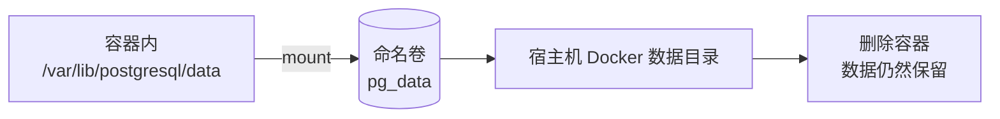
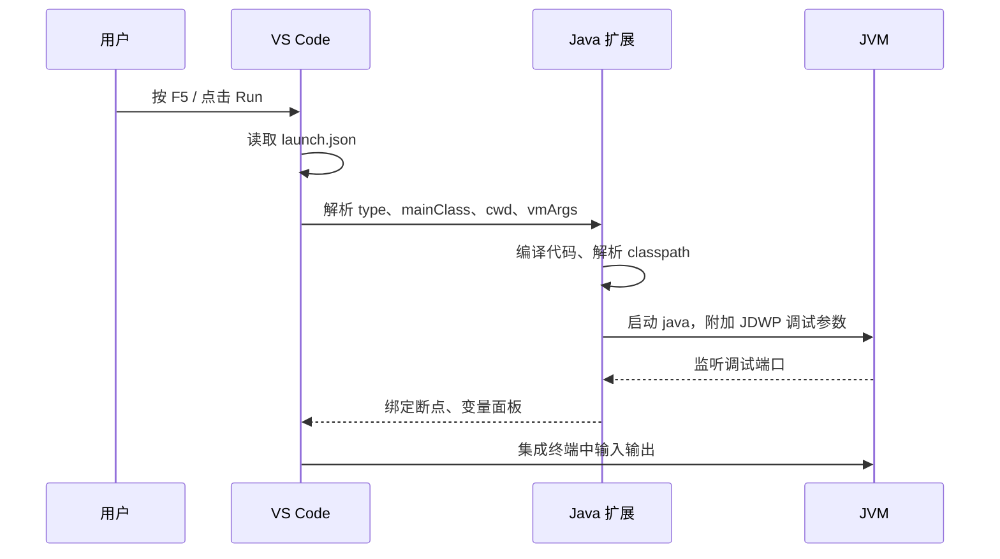

# 第一天报告

> 日期：2026-11-08  
> 学习项目：Java 学生成绩管理系统（`javatest`）  
> 技术栈：Java 24、控制台程序、文件持久化、包结构分层  
> 报告范围：第一天从语法错误、文件保存、中文编码到分层重构的完整过程  
> 阅读约定：从本报告开始，概念说明尽量附上最小可运行的代码或配置块，便于直接复制验证。

---

## 一、今天完成了什么

今天的工作可以分成两条线：

1. **Java 控制台项目**：把原来全部写在 `App.java` 里的学生管理系统，拆成 `model`、`service`、`ui` 三层；修复了保存失效、中文乱码、输入崩溃、重复学号、文件路径等问题。
2. **全栈项目术语复盘**：整理了 Maven、ORM、JPA、Docker、Spring Security、JWT、CI/CD 等概念，作为后续 Spring Boot 学习的基础。

需要特别说明：本仓库当前实际运行的是 **Java 控制台学生成绩管理系统**；报告中 Maven、Spring Boot、Docker、TypeScript 等术语来自另一条 Spring Boot 全栈学习线，两者不要混在一起理解。

---

## 二、最终项目结构

```text
test for study java/
├── .vscode/
│   └── settings.json
├── bin/                         ← 编译输出
│   ├── model/Student.class
│   ├── service/StudentManager.class
│   └── ui/App.class
├── lib/
├── src/
│   ├── model/
│   │   └── Student.java         ← 数据模型
│   ├── service/
│   │   └── StudentManager.java  ← 集合管理、文件读写、增删查改
│   └── ui/
│       └── App.java             ← 菜单、输入输出
├── students.txt                 ← 运行数据，UTF-8
└── README.md
```

分层后的依赖关系：

```text
ui.App  →  service.StudentManager  →  model.Student
                  ↓
             students.txt (UTF-8)
```

---

## 三、问题记录（按发生顺序）

### 1. `record expected` / `void is an invalid type`

**现象**

编译 `App.java` 时报：

```text
Syntax error on token "void", record expected
void is an invalid type for the variable saveToFile
Syntax error, insert "}" to complete ClassBody
```

**原因**

`updateStudent()` 方法缺少闭合的 `}`，导致后面的 `saveToFile()` 被编译器当成方法内部的声明；文件末尾又多了一个 `}`。

**解决**

在 `updateStudent()` 结束后补上 `}`，并删除文件末尾多余的 `}`。

**经验**

出现 “record expected”“void is an invalid type” 这类看似奇怪的错误时，优先检查**方法/类的大括号是否配对**，不要先怀疑关键字本身。

---

### 2. 写完保存了，但 `students.txt` 里没有新同学

**现象**

添加学生后提示“添加成功”，但重新打开 `students.txt` 看不到新数据。

**原因**

`saveToFile()` 只把学生转成 `lines` 列表，却**没有真正调用 `Files.write(...)`**。数据只存在内存里，程序结束后就丢了。

**解决**

补上文件写入：

```java
try {
    Files.write(DATA_FILE, lines, StandardCharsets.UTF_8);
} catch (IOException e) {
    System.out.println("保存失败：" + e.getMessage());
}
```

**经验**

“方法被调用了”不等于“副作用发生了”。写文件、发请求、改数据库这类操作，要检查真正的 I/O 调用是否存在，并用实际文件内容验证。

---

### 3. 中文乱码：文件里出现 `С??`、`??`

**现象**

输入姓名“小刚”，程序里显示或保存后变成乱码；`students.txt` 中出现替换字符。

**原因**

这里有两个不同的编码问题：

- `students.txt` 应该统一使用 **UTF-8**。
- Windows 控制台的输入输出编码可能是 **GBK**（`native.encoding=GBK`、`stdout.encoding=GBK`），而 Java 24 的 `Scanner` 默认用 UTF-8 解码控制台输入，两者不一致，中文就被拆坏了。

**解决**

- 文件读写明确指定 `StandardCharsets.UTF_8`。
- `Scanner` 使用控制台实际编码创建：

```java
static Charset consoleCharset() {
    String enc = System.getProperty("stdout.encoding");
    if (enc == null || enc.isBlank()) {
        enc = System.getProperty("native.encoding");
    }
    return (enc == null || enc.isBlank())
            ? StandardCharsets.UTF_8
            : Charset.forName(enc);
}
```

- 读取文件时处理 UTF-8 BOM，避免第一行学号带 `\uFEFF`：

```java
lines.set(0, lines.get(0).replace("\uFEFF", ""));
```

**验证**

“小刚”写入文件后的字节应为：

```text
E5 B0 8F E5 88 9A
```

**经验**

编码要分开看：**文件编码**和**控制台编码**是两件事。不要只在代码里写“UTF-8”就以为全部解决。

---

### 4. 拆包后编译报 `程序包 model 不存在`

**现象**

在 `src\ui` 目录下执行 `javac App.java`：

```text
App.java:13: 错误: 程序包model不存在
```

**原因**

`App.java` 引用了 `model.Student` 和 `service.StudentManager`，但只编译 `App.java` 时，编译器不知道 `src` 是源码根目录，也找不到另外两个包。

**解决**

从项目根目录一次编译所有源文件：

```powershell
cd "D:\Projects_for_study\javatest\test for study java"
javac -encoding UTF-8 -d bin src\model\Student.java src\service\StudentManager.java src\ui\App.java
```

运行时指定 `bin` 为类路径：

```powershell
java -cp bin ui.App
```

**经验**

- 包名必须和目录结构一致：`package model;` 对应 `src\model\Student.java`。
- 有包之后，启动类要写全限定名 `ui.App`，不能只写 `App`。
- `javac` 和 `java` 的类路径/源码路径要分清。

---

### 5. `students.txt` 到底在哪里？

**现象**

数据文件原来放在 `src\students.txt`，从不同目录启动程序时，有时能读到，有时会在别处新建一个空文件。

**原因**

`Paths.get("students.txt")` 是**相对当前工作目录**的，不是相对源码目录，也不是相对项目根目录。

**解决**

把 `students.txt` 统一放到项目根目录，并在项目根目录启动程序：

```powershell
cd "D:\Projects_for_study\javatest\test for study java"
java -cp bin ui.App
```

同时把 VS Code 的启动配置 `cwd` 固定到项目根目录。

**经验**

相对路径的“相对”取决于**运行时工作目录**，不是文件在磁盘上的位置。涉及数据文件时，最好明确约定一个固定启动目录，或者使用可配置的绝对路径。

---

### 6. 成绩输入字母导致程序崩溃

**现象**

在“成绩：”后输入 `abc`，程序抛出 `InputMismatchException` 并退出。

**原因**

`Scanner.nextInt()` / `nextDouble()` 只接受数字，输入不匹配时抛异常，而且**非法输入不会被自动消费**。如果 catch 后不清理，下一次读取还会读到同一个坏 token，可能陷入死循环。

**解决**

封装安全的读取方法：

```java
static int readInt(String prompt) {
    while (true) {
        System.out.print(prompt);
        try {
            int value = sc.nextInt();
            sc.nextLine();
            return value;
        } catch (InputMismatchException e) {
            System.out.println("输入无效，请输入整数");
            sc.nextLine(); // 清掉非法输入
        }
    }
}
```

`readDouble` 同理。成绩额外限制在 `0~100`，修改时允许 `-1` 表示跳过。

**经验**

处理控制台输入时，异常处理必须和“清空缓冲区”一起考虑。

---

### 7. 学号可以重复

**现象**

添加学号 `001` 两次都能成功；之后 `findById("001")` 永远返回第一条，修改/删除容易操作错对象。

**解决**

`StudentManager.add` 先查重，返回是否添加成功：

```java
public boolean add(Student s) {
    if (findById(s.getId()) != null) {
        return false;
    }
    students.add(s);
    saveToFile();
    return true;
}
```

`App` 根据返回值提示“添加成功”或“学号已存在”。`loadFromFile` 加载时也跳过重复学号。

**经验**

“唯一标识”的约束要在**写入入口**统一校验，不能只靠调用方自觉。

---

### 8. `getAll()` 暴露了内部集合

**现象**

`getAll()` 直接返回 `students`，外部代码可以绕过 `add/delete` 直接增删，导致文件没有同步保存。

**解决**

```java
public List<Student> getAll() {
    return Collections.unmodifiableList(students);
}
```

需要排序时先复制：

```java
List<Student> sorted = new ArrayList<>(students);
```

**经验**

封装不仅是“字段加 private”，还要控制集合的暴露方式。

---

### 9. `printMenu()` 是空实现

**现象**

程序启动后只显示“已加载 N 条记录”，没有菜单，看起来像卡住了。

**解决**

补全菜单，并新增“按成绩排序”选项：

```text
===== 学生成绩管理系统 =====
1. 添加学生
2. 查看所有学生
3. 按学号查找
4. 修改学生
5. 删除学生
6. 统计
7. 按成绩排序
0. 退出
请选择：
```

**经验**

空方法、`TODO`、占位注释在运行时不会报错，但会直接破坏用户体验。联调前先走一遍完整流程。

---

### 10. 旧的 `.class` 文件造成“改了没生效”

**现象**

拆分包之后，`src` 和 `bin` 里还残留旧结构生成的 `App.class`、`Student.class`、`Main.class`，容易运行到旧代码。

**解决**

删除旧的 `.class`，重新编译。正确输出应为：

```text
bin/model/Student.class
bin/service/StudentManager.class
bin/ui/App.class
```

`.gitignore` 已包含：

```text
bin/
*.class
```

**经验**

Java 运行时按类路径找 `.class`，残留文件可能比源码更“优先”。重构目录后先清理构建产物。

---

### 11. 编辑器旧缓冲区覆盖了新代码

**现象**

代码已经重构完成，但 VS Code 里未保存的旧缓冲区一保存，又把磁盘上的新代码覆盖回旧版本，于是再次出现 `list` 和 `package model 不存在`。

**解决**

关闭旧缓冲区并重新打开文件，或者使用“还原文件（Revert File）”，确认磁盘内容后再继续编辑。

**经验**

外部工具改过文件后，编辑器里的未保存内容可能是“过期状态”。看到代码和预期不一致时，先检查磁盘文件，而不是反复编译。

---

## 四、最终职责划分

| 层 | 类 | 职责 |
|---|---|---|
| `model` | `Student` | 学生数据、构造器、getter/setter、`toCsv()`、`toString()` |
| `service` | `StudentManager` | 学生集合、`add`、`delete`、`findById`、`getAll`、排序、文件读写 |
| `ui` | `App` | 菜单、`Scanner`、提示语、输入校验、调用 service |

关键行为：

- `add`：查重后添加并自动保存。
- `delete`：删除后自动保存。
- `update`：修改 `Student` 对象后调用 `manager.save()`。
- `loadFromFile`：启动时加载，跳过空行、格式错误、成绩非法、重复学号。
- `getAllSortedByScoreDesc`：成绩降序，同分按学号升序。

---

## 五、运行方式与验证结果

### 编译与运行

```powershell
cd "D:\Projects_for_study\javatest\test for study java"
javac -encoding UTF-8 -d bin src\model\Student.java src\service\StudentManager.java src\ui\App.java
java -cp bin ui.App
```

VS Code 中按 `F5`，选择 `App` 即可，启动类为 `ui.App`，工作目录已配置为项目根目录。

### 已验证的场景

- 菜单输入字母：提示“输入无效，请输入整数”，不会崩溃。
- 成绩输入字母：提示“输入无效，请输入数字”，可以重新输入。
- 添加学号 `005`：保存成功。
- 再次添加学号 `001`：提示“学号已存在”，不会写入重复数据。
- 按成绩排序：输出顺序为 `92.0 → 88.0 → 87.0 → 85.5 → 21.0`。
- 修改姓名和成绩：保存成功。
- 删除学生：文件和内存同步更新。
- 统计：人数、平均分、最高分计算正确。
- 文件编码：中文写入后为合法 UTF-8 字节。

测试在临时目录进行，没有改动真实 `students.txt`。

---

## 六、核心概念复盘：四大工程模块

以下术语来自 Spring Boot 全栈学习线，作为第一天的概念背景记录。

### 模块一：开发工具与包管理（我们依赖什么去干活？）

#### 1. Maven

- **专业定义**：Java 生态中的项目管理和构建自动化工具。
- **大白话**：Java 的“大管家”。
- **在项目里**：根据 `pom.xml` 自动下载 Spring Boot 依赖包，并把 Java 代码编译成可执行程序。报错 `No plugin found for prefix 'Spring-boot'`，本质是 Maven 找不到对应插件。

#### 2. npm / pnpm

- **专业定义**：Node Package Manager（Node 包管理器）及其高性能替代品。
- **大白话**：前端界的“大管家”。
- **在项目里**：前端使用 React、Tailwind 等开源代码，通过 pnpm 下载到 `node_modules` 目录。

#### 3. Node.js

- **专业定义**：基于 Chrome V8 引擎的 JavaScript 运行环境。
- **大白话**：让 JavaScript 脱离浏览器，直接在操作系统上运行的工具。
- **在项目里**：前端的构建工具 Vite、包管理器 pnpm 都运行在 Node.js 上。

### 模块二：数据库与数据持久化（数据存在哪？怎么管？）

#### 4. ORM（Object-Relational Mapping）

- **专业定义**：对象关系映射，把面向对象语言中的“对象”与关系型数据库中的“表”对应起来。
- **大白话**：翻译官。
- **在项目里**：Java 中有 `User` 类，数据库中有 `users` 表；使用 ORM 后直接操作 `User` 对象，它会翻译成 `INSERT INTO users...`，不需要手写 SQL。

#### 5. JPA / Hibernate

- **专业定义**：JPA 是 Java 官方的持久化规范，Hibernate 是它最流行的实现，Spring Data JPA 进一步封装。
- **大白话**：ORM 翻译官的“官方证书”和“最强打工人”。
- **在项目里**：`UserRepository` 继承 `JpaRepository` 后，只写 `findByEmail`，JPA 就能推导出 `SELECT * FROM users WHERE email = ?`。

#### 6. Flyway

- **专业定义**：数据库版本控制工具（Database Migration Tool）。
- **大白话**：数据库的“Git”。
- **在项目里**：`V1__create_users_table.sql` 在启动时自动执行；以后加字段写 `V2__add_column.sql`，保证所有环境数据库结构一致。

#### 7. Docker / Container / Volume

- **专业定义**：容器化技术，把应用及其依赖打包在隔离进程中运行；Volume 是持久化数据卷。
- **大白话**：集装箱；Volume 是外挂的“移动硬盘”。
- **在项目里**：用 Docker 运行 PostgreSQL，不必在电脑上安装数据库软件；`pg_data` 数据卷保证容器删除后数据仍然保留。

### 模块三：后端架构与安全（服务怎么建？怎么防？）

#### 8. Spring Boot

- **专业定义**：基于 Spring 框架、遵循“约定优于配置”的快速开发脚手架。
- **大白话**：傻瓜式的智能组装工厂。
- **在项目里**：内置 Tomcat，启动后监听 8080 端口。

#### 9. RESTful API

- **专业定义**：基于 HTTP 协议的接口设计风格，使用 GET、POST、PUT、DELETE 等动词表达操作。
- **大白话**：前后端交流的“暗号规则”。
- **在项目里**：`/health` 使用 GET，注册接口使用 POST。

#### 10. Spring Security

- **专业定义**：Spring 生态中的安全框架，提供认证（Authentication）和授权（Authorization）。
- **大白话**：保安和门禁系统。
- **在项目里**：引入后默认拦截所有请求，包括 `/health`。认证解决“你是谁”，授权解决“你能干什么”。

#### 11. JWT（JSON Web Token）

- **专业定义**：一种开放标准（RFC 7519），用于在各方之间以 JSON 对象安全传输信息。
- **大白话**：带有防伪印章的“电子通行证”。
- **在项目里**：登录成功后后端签发 JWT；前端后续携带 JWT 访问受保护接口，后端验证签名即可识别用户，不必每次都查数据库验证密码。

### 模块四：工程化与自动化（怎么保证不出错？）

#### 12. CI/CD（Continuous Integration / Continuous Deployment）

- **专业定义**：持续集成与持续部署。
- **大白话**：自动化的质检员与送货员。
- **在项目里**：GitHub Actions 在提交代码后自动启动机器、安装 Java、拉起临时数据库、运行测试；测试不通过就不允许合并。

#### 13. YAML

- **专业定义**：一种人类可读的数据序列化格式，常用于配置文件。
- **大白话**：极度依赖空格缩进的配置文件格式。
- **在项目里**：`docker-compose.yml` 和 `ci.yml` 都是 YAML；报错 `Required property is missing: jobs` 通常是缩进层级错误。

#### 14. TypeScript（TS）

- **专业定义**：JavaScript 的超集，增加了静态类型系统。
- **大白话**：给 JavaScript 加上“数据校验”的紧箍咒。
- **在项目里**：前端使用 TS，变量声明为数字后传入字符串，编辑器会立即报错，不必等到运行时才发现。

### 术语复盘小结

这些术语不需要死记硬背。继续写注册、登录、Security 拦截规则时，它们会变成每天敲的代码，例如 `@Entity`、`@Repository`、`JwtBuilder`。工程能力是在“看术语 → 写代码 → 报错 → 查术语”的循环里长出来的。

---

## 七、深入理解 Docker Volume

### 7.1 为什么需要 Volume

容器默认的文件系统是“临时的”：

- 镜像层是只读的。
- 容器启动后会在镜像层之上加一个可写层。
- 容器删除时，这个可写层也会被删除。

所以，如果把 PostgreSQL 的数据直接写在容器可写层里，执行 `docker rm` 之后数据就没了。Volume（数据卷）就是把这个目录“外挂”到容器外面，让数据的生命周期独立于容器。



### 7.2 Volume 的原理

Docker 在 Linux 上主要依赖 **namespace、cgroups 和联合文件系统（如 overlay2）**：

1. 镜像由多层只读文件系统组成。
2. 容器启动时，Docker 在镜像之上创建一个可写层。
3. 容器进程看到的是一个合并后的文件系统。
4. 删除容器时，可写层随之销毁。

Volume 不参与这套“镜像 + 可写层”的联合文件系统，而是由 Docker 在宿主机上管理一个真实目录，然后通过 **bind mount** 把这个目录挂载进容器的 mount namespace。容器内对挂载点的读写会直接落到宿主机目录。

关键点：

- Volume 的生命周期独立于容器。
- 默认驱动是 `local`，数据通常位于 Linux 的 `/var/lib/docker/volumes/` 下。
- 在 Windows/macOS 的 Docker Desktop 中，数据实际存放在 Docker 的虚拟机（WSL2 或 HyperKit）里，不是直接放在 Windows 的普通目录中。
- 删除容器不会删除命名卷；只有显式删除卷才会丢数据。

### 7.3 三种常见挂载方式

| 方式 | 写法示例 | 数据位置 | 生命周期 | 适用场景 |
|---|---|---|---|---|
| 命名卷 Named Volume | `-v pg_data:/var/lib/postgresql/data` | Docker 管理 | 独立于容器 | 数据库、需要持久化的数据 |
| 绑定挂载 Bind Mount | `-v ./data:/var/lib/postgresql/data` | 宿主机指定目录 | 由宿主机目录决定 | 开发时挂载配置、初始化 SQL |
| 临时文件系统 tmpfs | `--tmpfs /tmp` | 内存 | 容器停止即消失 | 敏感临时文件、缓存 |

数据库优先使用**命名卷**；开发时可以用**绑定挂载**把初始化脚本挂进容器。

### 7.4 Compose 中的关键配置

下面是一个 PostgreSQL 的 `docker-compose.yml`：

```yaml
services:
  postgres:
    image: postgres:16
    container_name: demo-postgres
    environment:
      POSTGRES_DB: appdb
      POSTGRES_USER: appuser
      POSTGRES_PASSWORD: apppass
    ports:
      - "5432:5432"
    volumes:
      - pg_data:/var/lib/postgresql/data
      - ./init.sql:/docker-entrypoint-initdb.d/init.sql:ro
    healthcheck:
      test: ["CMD-SHELL", "pg_isready -U appuser -d appdb"]
      interval: 5s
      timeout: 3s
      retries: 10

volumes:
  pg_data:
```

要点：

- `volumes:` 顶级字段用于**声明命名卷** `pg_data`。
- `services.postgres.volumes` 用于**把卷挂载到容器路径**。
- `pg_data:/var/lib/postgresql/data` 中，冒号左边是卷名，右边是容器内路径。
- `./init.sql:/docker-entrypoint-initdb.d/init.sql:ro` 是绑定挂载，`ro` 表示只读。
- PostgreSQL 官方镜像会在数据目录为空时执行初始化；如果挂载的卷里已经有数据，则不会重复初始化。

### 7.5 常用命令

```bash
# 创建命名卷
docker volume create pg_data

# 查看所有卷
docker volume ls

# 查看卷的详细信息，包括宿主机挂载点
docker volume inspect pg_data

# 启动 Compose 服务
docker compose up -d

# 查看容器状态
docker compose ps

# 查看数据库日志
docker compose logs -f postgres

# 停止并删除容器、网络，但保留命名卷
docker compose down

# 停止并删除容器、网络、命名卷（数据会丢失）
docker compose down -v
```

`docker compose down` 和 `docker compose down -v` 的区别非常重要：

- `down`：容器没了，卷还在，下次启动数据还在。
- `down -v`：卷也被删除，数据库回到全新状态。

### 7.6 验证数据是否真正持久化

```bash
# 第一次启动
docker compose up -d

# 写入一条测试数据
docker compose exec postgres \
  psql -U appuser -d appdb \
  -c "create table if not exists t(id int); insert into t values (1);"

# 删除容器，但保留卷
docker compose down

# 重新启动
docker compose up -d

# 再查一次，数据应该还在
docker compose exec postgres \
  psql -U appuser -d appdb \
  -c "select * from t;"
```

如果把 `docker compose down` 换成 `docker compose down -v`，再执行同样的查询，表就不存在了。这就是 Volume 生命周期最直观的验证。

### 7.7 备份与恢复

Volume 不是备份。数据库还在运行时，直接复制数据文件可能得到不一致的结果。更稳妥的方式是使用 PostgreSQL 自带的 `pg_dump`：

```bash
docker compose exec postgres \
  pg_dump -U appuser -d appdb > backup.sql
```

恢复：

```bash
docker compose exec -T postgres \
  psql -U appuser -d appdb < backup.sql
```

如果确实要备份整个卷，可以启动一个临时容器，把卷和宿主机目录同时挂载进去：

```bash
docker run --rm \
  -v pg_data:/data \
  -v "${PWD}:/backup" \
  alpine sh -c "tar czf /backup/pg_data.tar.gz -C /data ."
```

### 7.8 常见坑

1. **`docker compose down -v` 会删数据**：执行前确认卷名，不要在生产环境随手加 `-v`。
2. **挂载点覆盖镜像内容**：把卷挂到非空目录时，镜像里原有的内容会被遮住。数据库镜像依赖这个特性来决定是否初始化。
3. **权限问题**：容器内进程的 UID/GID 与宿主机目录权限不匹配时，可能无法写入。PostgreSQL 官方镜像通常使用特定 UID。
4. **Windows 路径**：绑定挂载的路径要写对，Compose 中的相对路径是相对 `docker-compose.yml` 所在目录。
5. **匿名卷**：`-v /var/lib/postgresql/data` 不写卷名会创建匿名卷，难以管理；应使用命名卷。
6. **Volume 不等于备份**：卷可能被误删、磁盘可能损坏，重要数据仍要定期 `pg_dump`。
7. **Flyway 与 Volume 的关系**：卷保留的是数据库状态，也包括 Flyway 的 `flyway_schema_history` 表。删除卷后，下次启动会重新执行所有迁移脚本。

---

## 八、深入理解 launch.json

### 8.1 launch.json 是什么

`launch.json` 是 VS Code 的**调试启动配置**文件，不是 Java 专属文件。它告诉 VS Code：

- 启动哪个程序；
- 用什么调试器；
- 工作目录是什么；
- 传什么启动参数和环境变量；
- 使用哪个终端。

文件位置通常是：

```text
<workspace>/.vscode/launch.json
```

VS Code 使用 JSONC 格式，允许写注释，但整体仍然必须是合法 JSON 结构。

### 8.2 F5 背后发生了什么



所以 `launch.json` 本质上是在描述“**如何启动一个可调试的进程**”，而不是在描述 Java 代码本身。

### 8.3 关键字段

| 字段 | 作用 | 本项目示例 |
|---|---|---|
| `type` | 使用哪个调试器 | `"java"` |
| `request` | 启动新进程还是连接已有进程 | `"launch"` 或 `"attach"` |
| `name` | 在运行和调试下拉框中显示的名字 | `"App"` |
| `mainClass` | 入口类，必须写全限定名 | `"ui.App"` |
| `projectName` | Java 扩展识别的项目名 | `"javatest_61e85f1c"` |
| `console` | 输出到哪里 | `"integratedTerminal"` |
| `cwd` | 进程的工作目录 | `"${workspaceFolder}/test for study java"` |
| `vmArgs` | 传给 JVM 的参数 | `"-Dfile.encoding=UTF-8"` |
| `args` | 传给 `main(String[] args)` 的程序参数 | `["--debug"]` |
| `env` | 环境变量 | `{ "APP_ENV": "dev" }` |

### 8.4 本项目的配置

```json
{
  "version": "0.2.0",
  "configurations": [
    {
      "type": "java",
      "name": "App",
      "request": "launch",
      "mainClass": "ui.App",
      "projectName": "javatest_61e85f1c",
      "console": "integratedTerminal",
      "cwd": "${workspaceFolder}/test for study java"
    },
    {
      "type": "java",
      "name": "Current File",
      "request": "launch",
      "mainClass": "${file}",
      "console": "integratedTerminal",
      "cwd": "${workspaceFolder}/test for study java"
    }
  ]
}
```

几个容易出错的点：

- 有包之后，`mainClass` 必须写 `ui.App`，不能只写 `App`。
- `projectName` 要和 Java 扩展识别到的项目名一致；项目改名后它可能失效。
- `cwd` 决定 `students.txt` 这类相对路径的解析位置。
- `console` 设为 `integratedTerminal`，交互式 `Scanner` 才能正常接收输入。
- `launch.json` 里的 `mainClass` 和 Node.js 的 `program` 不是一回事，不能混用。

### 8.5 launch 与 attach

`launch` 是让 VS Code 启动一个新 JVM：

```json
{
  "type": "java",
  "name": "Launch App",
  "request": "launch",
  "mainClass": "ui.App"
}
```

`attach` 是连接一个已经在运行的 JVM：

```json
{
  "type": "java",
  "name": "Attach to 5005",
  "request": "attach",
  "hostName": "localhost",
  "port": 5005
}
```

被连接的 JVM 需要以调试模式启动：

```bash
java -agentlib:jdwp=transport=dt_socket,server=y,suspend=n,address=*:5005 \
  -cp bin ui.App
```

参数含义：

- `transport=dt_socket`：使用 socket 通信。
- `server=y`：当前 JVM 作为调试服务端。
- `suspend=n`：启动时不等调试器；改成 `y` 会等调试器连上再继续。
- `address=*:5005`：监听 5005 端口。

### 8.6 变量替换

VS Code 支持在配置里使用变量：

```json
{
  "cwd": "${workspaceFolder}/test for study java",
  "mainClass": "${file}",
  "env": {
    "JAVA_HOME_COPY": "${env:JAVA_HOME}"
  }
}
```

常见变量：

| 变量 | 含义 |
|---|---|
| `${workspaceFolder}` | 当前工作区根目录 |
| `${file}` | 当前打开文件的路径 |
| `${fileDirname}` | 当前文件所在目录 |
| `${env:NAME}` | 环境变量 `NAME` 的值 |

`"mainClass": "${file}"` 适合“运行当前文件”的场景；固定入口类时直接写 `ui.App` 更明确。

### 8.7 cwd 与相对路径

这是本项目实际踩过的坑。程序里的：

```java
private static final Path DATA_FILE = Paths.get("students.txt");
```

表示“当前工作目录下的 `students.txt`”。所以：

```json
"cwd": "${workspaceFolder}/test for study java"
```

会让 VS Code 在项目根目录启动 JVM，从而读写项目根目录的 `students.txt`。如果 `cwd` 配错，程序不会报错，而是会在另一个目录悄悄新建一个空文件。

命令行等价写法：

```powershell
cd "D:\Projects_for_study\javatest\test for study java"
java -cp bin ui.App
```

### 8.8 控制台与编码

`console` 常见取值：

- `"integratedTerminal"`：使用 VS Code 集成终端，适合需要键盘输入的 `Scanner` 程序。
- `"internalConsole"`：使用调试控制台，交互式输入能力较弱。

如果终端是 GBK，而 JVM 被强制成 UTF-8，中文输入输出会乱码。只有在终端和 JVM 编码统一时才这样写：

```json
"vmArgs": "-Dfile.encoding=UTF-8 -Dstdout.encoding=UTF-8 -Dstdin.encoding=UTF-8"
```

本项目没有强写 `vmArgs`，而是在代码里根据 `stdout.encoding` / `native.encoding` 选择控制台编码，文件则固定使用 UTF-8。这样更不容易出现“终端能显示、文件却写坏”的问题。

### 8.9 调试技巧

1. 在 `App.java` 的 `switch` 行左侧点击红点设置断点。
2. 按 `F5`，选择 `App`。
3. 程序停在断点后，在 Variables 面板查看 `choice`、`manager`、`students`。
4. `F10` 单步跳过，`F11` 单步进入。
5. 可以设置条件断点，例如：

```text
choice == 1
```

6. 在 Debug Console 里执行表达式：

```text
manager.getAll()
manager.findById("001")
```

注意：Debug Console 里的表达式求值不会自动触发文件保存，它只用于观察状态。

### 8.10 常见问题

| 现象 | 可能原因 | 处理 |
|---|---|---|
| `ClassNotFoundException` / 找不到主类 | `mainClass` 少了包名 | 改成 `ui.App` |
| 改了代码但运行结果没变 | 旧 `.class` 残留或编译失败 | 清理 `bin` 后重新编译 |
| 数据文件跑到别处 | `cwd` 不对 | 固定 `cwd` 到项目根目录 |
| 中文输入乱码 | 终端编码与 JVM 编码不一致 | 统一编码，或按控制台编码创建 `Scanner` |
| 断点不生效 | 运行的不是当前代码 | 检查启动配置和构建输出 |
| 下拉框里没有 `App` | `launch.json` 不在正确的 `.vscode` 目录 | 放到工作区根目录的 `.vscode` |
| `launch.json` 报语法错误 | 注释、逗号、括号不合法 | 用 JSONC 校验，去掉多余逗号 |

---

## 九、补充发现与改进建议

以下是今天代码里还能继续改进的点，按优先级排列。

### 1. CSV 解析过于简单

现在用 `line.split(",")`，如果姓名里包含逗号，字段就会错位。更稳妥的做法是使用 CSV 库，或者至少限制格式并在写入时做转义。

### 2. 文件写入不是原子操作

`Files.write` 直接覆盖原文件。如果写到一半程序崩溃，文件可能被截断。可以先写临时文件，再原子替换：

```java
Path temp = Files.createTempFile("students", ".tmp");
Files.write(temp, lines, StandardCharsets.UTF_8);
Files.move(temp, DATA_FILE,
        StandardCopyOption.REPLACE_EXISTING,
        StandardCopyOption.ATOMIC_MOVE);
```

### 3. 数据路径仍然依赖工作目录

把文件移到项目根目录并固定启动目录已经能解决当前问题，但 `students.txt` 仍是相对路径。更稳的方案是通过系统属性指定：

```java
Path dataFile = Paths.get(
        System.getProperty("student.data", "students.txt"));
```

启动时传 `-Dstudent.data=...`，或者使用绝对路径。

### 4. service 层直接 `System.out`

`StudentManager` 里的“已加载”“保存失败”等输出属于 UI 职责。更纯粹的做法是返回结果对象或抛出异常，由 `ui.App` 决定怎么显示。

### 5. 缺少单元测试

目前靠手工输入验证。建议用 JUnit 5 覆盖：

- 添加学生
- 重复学号
- 按学号查找
- 删除
- 排序
- 加载格式错误/重复行
- 保存后重新读取

### 6. `Scanner` 的 EOF 没有处理

用户按 `Ctrl+Z` 结束输入时，`nextInt()` 会抛 `NoSuchElementException`。可以捕获并退出程序。

### 7. 命名与不可变性

- `Student.ID` 建议改成 `id`，符合 Java 命名规范。
- 学号一旦创建就不应修改，可以考虑 `final`。
- `StudentManager` 目前不是线程安全的；控制台单用户场景没问题，但多线程访问需要额外处理。

### 8. 配置与数据文件的 Git 管理

- `.vscode/` 被 `.gitignore` 忽略，所以 `launch.json` 的修改不会提交。
- `students.txt` 目前没有被忽略，个人测试数据可能被提交。如果它是运行数据，建议加入 `.gitignore`；如果希望保留示例数据，可以改名为 `students.sample.txt`。
- README 里的 `.vscode/` 位置和实际仓库根目录的配置不完全一致，可以后续统一。

### 9. 没有日志与备份

目前出错只打印到控制台。后续可以引入 `java.util.logging` 或 SLF4J，并对数据文件做备份。

---

## 十、今日收获

1. 看到奇怪的语法错误，先检查大括号和方法边界。
2. 有 I/O 的方法必须验证真实副作用，不能只看“方法执行了”。
3. 文件编码和控制台编码是两件事，中文乱码要分别排查。
4. Java 包结构必须和目录一致，编译、运行都要正确处理类路径。
5. 相对路径依赖工作目录，数据文件要有明确约定。
6. 输入校验要同时处理“异常”和“清空非法输入”。
7. 唯一约束要放在写入入口，不能依赖调用方。
8. 分层不是把文件挪进文件夹，而是明确每层的职责和依赖方向。
9. 构建产物、编辑器缓冲、旧 `.class` 都可能让“代码明明改了却不生效”。
10. Volume 的本质是把宿主机目录挂进容器，数据生命周期独立于容器；`down -v` 会连数据一起删除。
11. `launch.json` 描述的是“如何启动和调试进程”，`mainClass`、`cwd`、`console`、`vmArgs` 都会直接影响运行结果。
12. 工程能力来自不断经历“看术语 → 写代码 → 报错 → 修正”的循环。

---

## 十一、下一步计划

1. 给 `StudentManager` 补充 JUnit 5 单元测试。
2. 把文件写入改成临时文件 + 原子替换。
3. 让 service 层不再直接打印，改为返回结果。
4. 处理 `Scanner` 的 EOF 情况。
5. 继续 Spring Boot 全栈线：Spring Security 配置、注册与登录接口、JWT 签发与校验。
